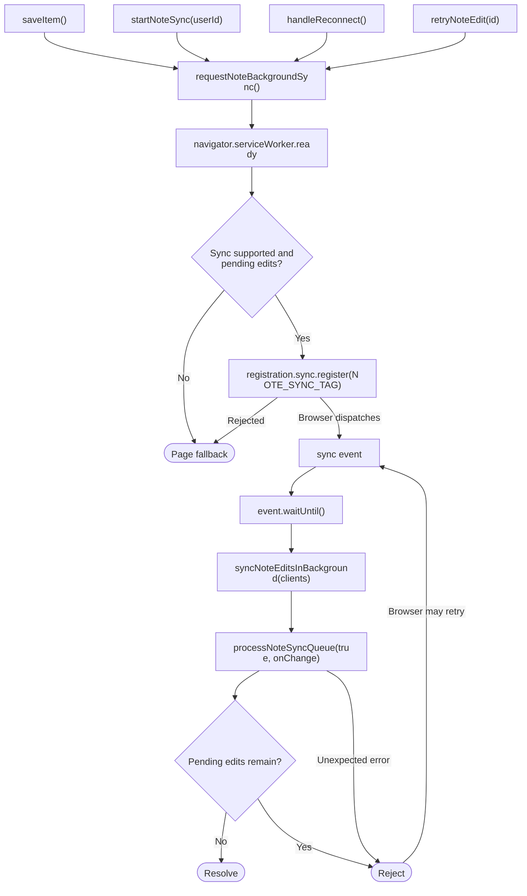
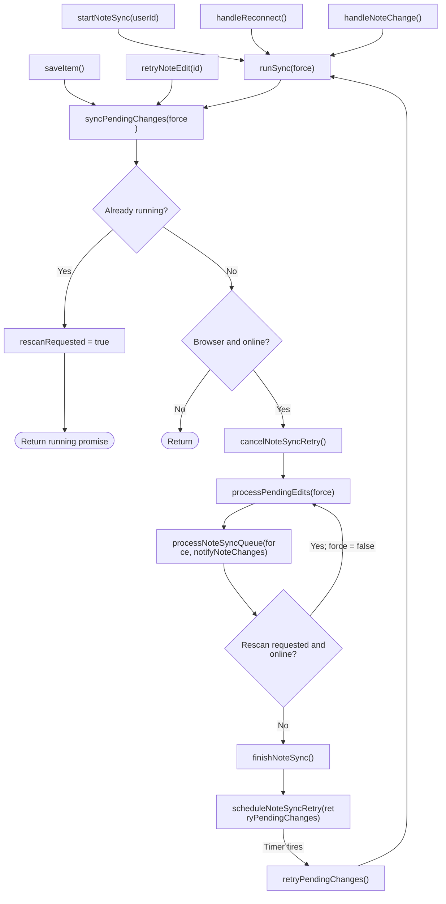

# Note synchronization flow

Edits to existing notes are saved in IndexedDB first, whether online or offline.
The page and service worker share a queue processor that sends those edits to
the server when online. Background Sync is optional; page startup and reconnect
remain the fallback.

## Current module structure

| File | Responsibility |
| --- | --- |
| [index.ts](../src/lib/products/note-sync/index.ts) | Public exports used by the editor, notes, and app shell. |
| [sync.ts](../src/lib/products/note-sync/sync.ts) | Page startup, browser events, runtime state, retry timers, and manual actions. |
| [engine.ts](../src/lib/products/note-sync/engine.ts) | Shared queue processing, uploads, and locking for pages and the worker. |
| [background-sync.ts](../src/lib/products/note-sync/background-sync.ts) | Background Sync registration and shared event identifiers. |
| [worker.ts](../src/lib/products/note-sync/worker.ts) | Runs the shared processor, notifies pages, and reports unfinished work. |
| [sw.ts](../src/app/sw.ts) | Service worker caching and the Background Sync event listener. |
| [storage.ts](../src/lib/products/note-sync/storage.ts) | IndexedDB reads and updates, upload preparation, acknowledgements, and retry policy. |
| [save-item.ts](../src/lib/products/save-item.ts) | Saves edits locally, refreshes the notes, and requests synchronization. |
| [note-edits.ts](../src/lib/products/note-edits.ts) | Defines stored edits and overlays them onto notes notes. |

## Background Sync flowchart

The charts contain control flow and method names. Explanations follow outside
each chart.

1. Saving, startup, reconnection, and manual retry request background work.
   `requestNoteBackgroundSync()` returns immediately if there is no service
   worker API. Otherwise, it waits for an active worker, checks for Background
   Sync support and pending edits, then registers `fieldkit-note-edits`.
2. Registration runs separately from the page's immediate synchronization. An
   unsupported API or rejected registration leaves the page fallback available.
3. [sw.ts](../src/app/sw.ts) handles only the matching tag and passes the worker
   task to `event.waitUntil()` to extend the event lifetime.
4. `syncNoteEditsInBackground()` runs the shared queue with `force = true` on the
   first pass. Its change callback sends `NOTE_SYNC_CHANGED` to open pages, where
   `handleWorkerNoteChange()` refreshes the notes and requests a page scan.
5. If pending edits remain, the task rejects so the browser may retry. Failed
   edits needing manual attention do not request automatic retries. No page
   timer is used inside the worker. Browser scheduling and retry limits mean
   background completion is not guaranteed; see the
   [Background Sync specification](https://wicg.github.io/background-sync/spec/).

## Page fallback flowchart

## Methods in flow order

1. **Save or start:** `saveItem()` stores a pending edit, calls
   `notifyNoteChanges()`, and requests synchronization. The
   [authenticated user provider](../src/components/auth/user-provider.tsx) calls
   `startNoteSync(userId)`, which adds listeners on the first subscription and calls
   `runSync(true)`.
2. **Handle events:** `handleReconnect()` calls `runSync(true)`;
   `handleNoteChange()` refreshes the notes and calls `runSync()`.
   `runSync()` catches and logs unexpected synchronization errors.
3. **Start one run:** `syncPendingChanges()` requests a rescan if a run already
   exists. Otherwise, it returns when offline or outside the browser, cancels the
   retry timer, and starts `processPendingEdits()`.
4. **Request a pass:** `processPendingEdits()` clears the rescan flag and calls
   the shared `processNoteSyncQueue()` in `engine.ts`.
5. **Coordinate and drain:** `processNoteSyncQueue()` uses `withNoteSyncLock()`.
   It waits if another page or the worker holds the lock. Without Web Locks,
   processing runs directly. While holding the lock, it repeats `syncQueuePass()`
   while a pass makes progress and the browser stays online.
6. **Select edits:** `syncQueuePass()` reads edits oldest first.
   `isReadyToSync()` selects pending edits whose retry time has arrived, or
   pending edits selected by `force`. Each eligible edit goes to `syncEdit()`.
7. **Prepare and upload:** `syncEdit()` calls `prepareNoteEditAttempt()` to
   preserve the submitted revision. If no attempt is available, it skips the
   edit. Otherwise, `uploadNoteEdit()` sends a PATCH request with the payload and
   version string, using a 15-second timeout. The
   [note API](../src/app/api/notes/[id]/route.ts) checks the version before saving.
8. **Record the result:** On success, `acknowledgeNoteEdit()` saves the returned
   version and marks the edit synced, or keeps a newer local revision pending.
   On failure, `recordNoteSyncFailure()` keeps the edit pending with a retry delay
   or marks it failed. Both paths call `notifyNoteChanges()` to refresh the
   notes and broadcast the change. The worker uses a page message instead
   of this page-specific callback.
9. **Repeat if needed:** A successful edit makes the pass count as progress.
   After draining, `processPendingEdits()` checks for a requested rescan and
   repeats while online. Forced processing applies only to the first pass;
   later passes respect retry delays.
10. **Finish and schedule:** `finishNoteSync()` clears the running promise and
    calls `scheduleNoteSyncRetry()`. With subscribers, connectivity, and pending
    edits, it sets a timer for the earliest retry time, at least one second
    away. The timer calls `retryPendingChanges()`, which calls `runSync()` again.

## Manual actions and cleanup

- `retryNoteEdit(id)` calls `resetNoteEditForRetry()`, notifies the notes and
  other tabs, requests Background Sync, then calls `syncPendingChanges(true)`.
- `discardNoteEdit(id)` removes the local edit under the same browser lock. When
  Web Locks are unavailable, it waits for the current local run first. It then
  calls `notifyNoteChanges()`.
- `startNoteSync(userId)` returns `stopNoteSync()` for cleanup. The last subscriber
  leaving triggers `unsubscribeFromNoteSyncEvents()` and `cancelNoteSyncRetry()`.
  This removes page listeners and the retry timer; it does not abort an active
  upload or cancel registered Background Sync work.

## Current behavior

- Queue processing verifies the current session and selects only that account's
  local edits. Uploads include the expected user ID; the API checks ownership.
- Legacy local edits belong to the original demo account. Retry and discard
  also check the local owner.

- Synced snapshots remain in IndexedDB; they are not automatically deleted.
- If another edit is queued during an upload, it stays pending for the next pass.
- Network errors, timeouts, HTTP 408/429, and server failures retry with
  exponential backoff capped at 60 seconds while the app is open and online.
  Background Sync attempts use the browser's retry scheduling instead.
- Authentication, validation, and version errors retain the local edit for
  manual retry or discard in the
  [sync status controls](../src/components/fieldkit/notes/note-sync-status.tsx).
- New notes created offline are not synchronized yet.
