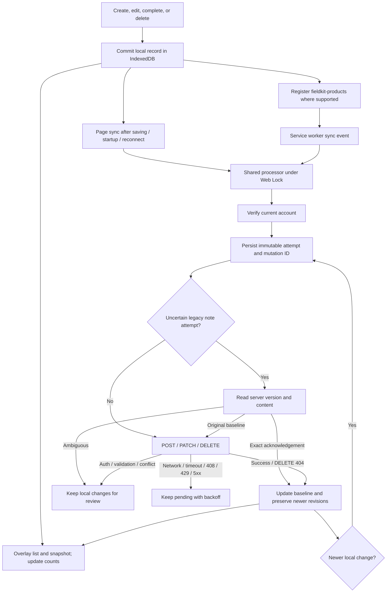

# Shared task and note synchronization

Tasks and notes use the same durable queue, scheduler, processor, and service
worker. Task and note adapters validate their respective fields and merge them
into the UI. Task completion is a regular task payload update.

| Module | Responsibility |
| --- | --- |
| `product-sync/model.ts` | Typed change records and immutable upload attempts |
| `product-sync/migration.ts` | Version-5 records to version-6 format, without clearing data |
| `product-sync/writes.ts` | Local creation, editing, completion, and deletion |
| `product-sync/storage.ts` | Queue reads, attempts, acknowledgements, retries, and list snapshots |
| `product-sync/adapters.ts` | Task/note overlays, counts, timestamps, and deletion markers |
| `product-sync/engine.ts` | Session checks, queue processing, and legacy reconciliation |
| `product-sync/runtime.ts` | Startup/reconnect lifecycle, timers, tab updates, retry/discard |
| `product-sync/locks.ts` | Shared page/worker lock and transition locks |
| `product-sync/background-sync.ts` | One registration tag and legacy aliases |
| `product-sync/worker.ts` | Shared processor, client notifications, and badge refresh |
| `product-mutations.ts` | Account/kind-scoped server mutation receipts |

All module paths above are relative to `src/lib/products/`.

A never-attempted local creation can be canceled without a request. Once an
attempt exists, deleting the item preserves that request until its outcome is
known, then deletes the acknowledged server identity/version. Synced deletion
markers hide stale cached records. Failed deletions reappear with Retry and
Keep note/task controls.

List snapshots and queue entries are owned by an account. Uploads include an
expected-account header checked by the API. Account changes cancel scheduling
for the old session without deleting its pending work. Web Locks serialize
uploads/retry/discard across tabs and the worker; local writes use atomic
IndexedDB transactions and can add newer revisions during an upload.

The service worker accepts the old `fieldkit-note-edits` and
`fieldkit-task-changes` tags as aliases. All registrations for new saves use
`fieldkit-products`; all current worker notifications use
`fieldkit-products-changed`. Old notification strings remain accepted.

The version-6 upgrade preserves older task attempts and mutation IDs, saved
note edits, numeric offline note creations, snapshots, and unknown records.
Numeric notes gain stable UUIDs and retain legacy aliases. Missing legacy
owners belong to the original demo account. Old note attempts without mutation
IDs are reconciled before upload; ambiguous results stay available for review.

Page retries and session lookup failures back off up to 60 seconds.
Background Sync scheduling is controlled by the browser and cannot guarantee
completion after every page closes. Attachments and unsaved drafts do not use
this queue. Server records and mutation receipts remain process-local demo data.
The worker also accepts the optional `fieldkit-products-periodic` event for
browsers that provide Periodic Background Sync, with the same foreground and
normal Background Sync fallbacks.
